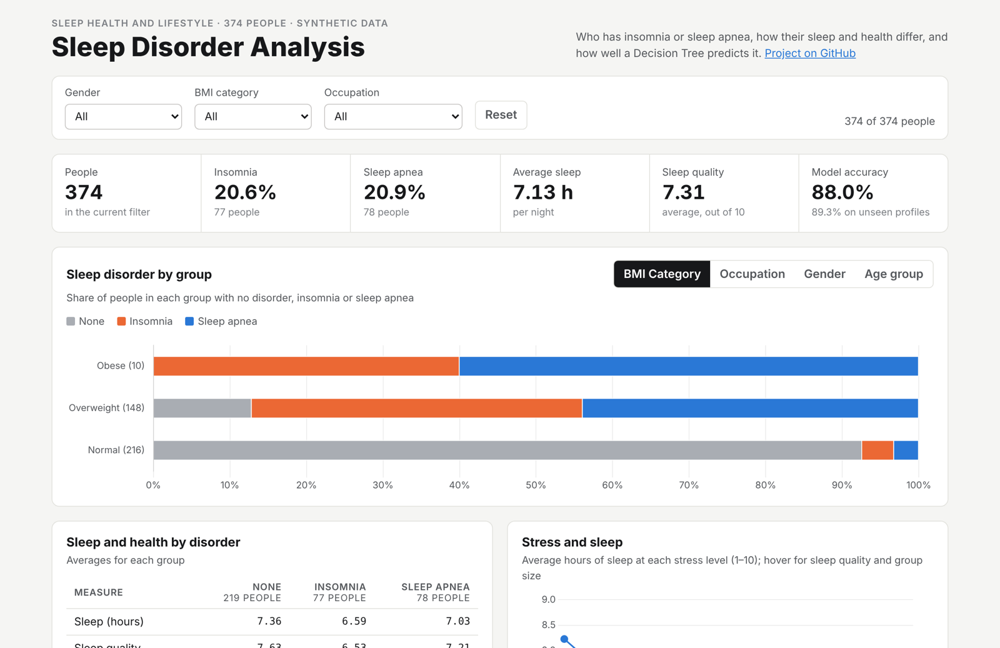
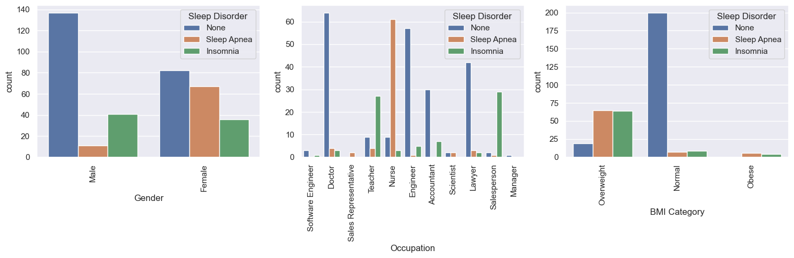
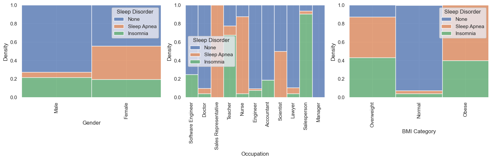
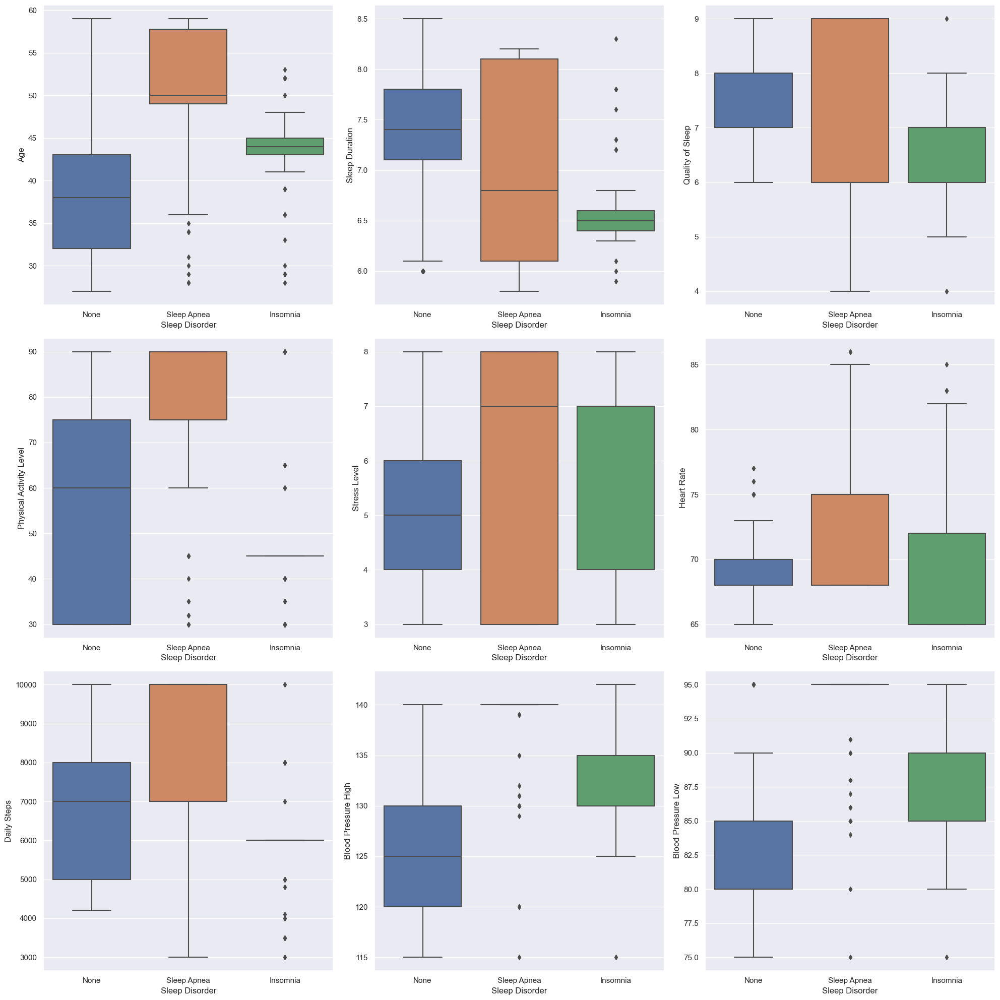
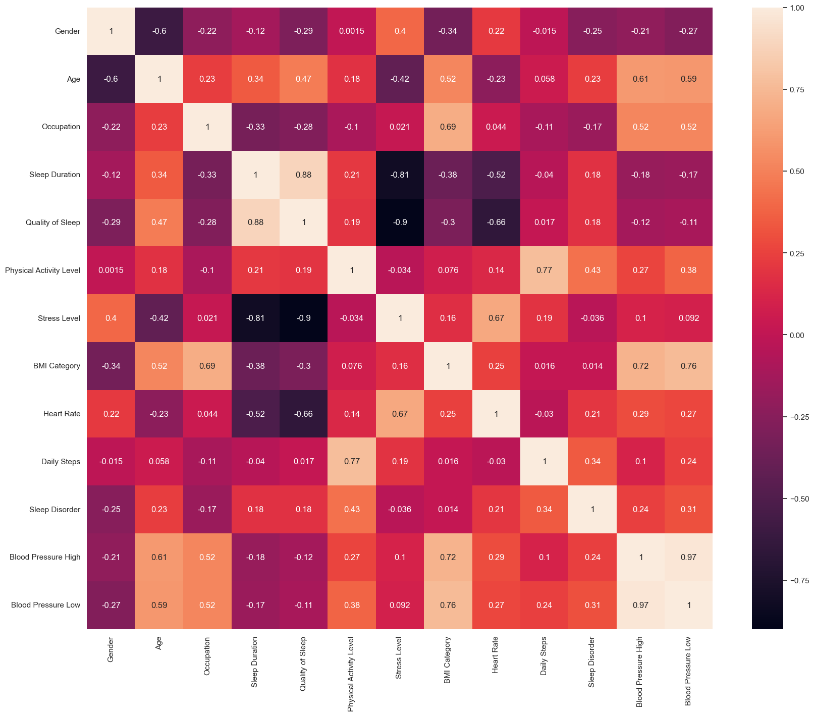
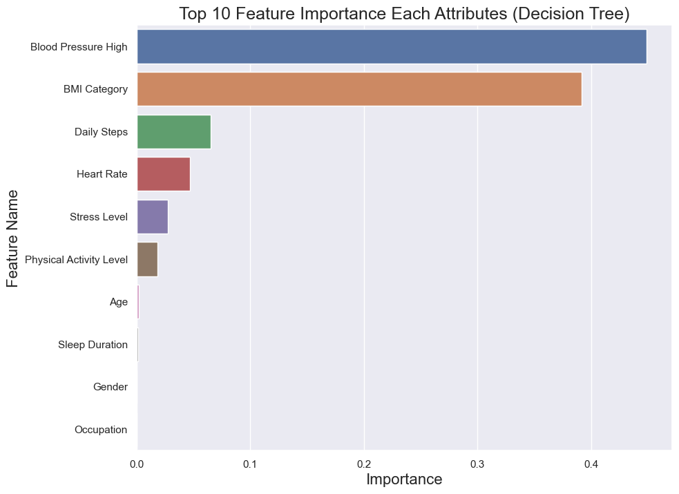
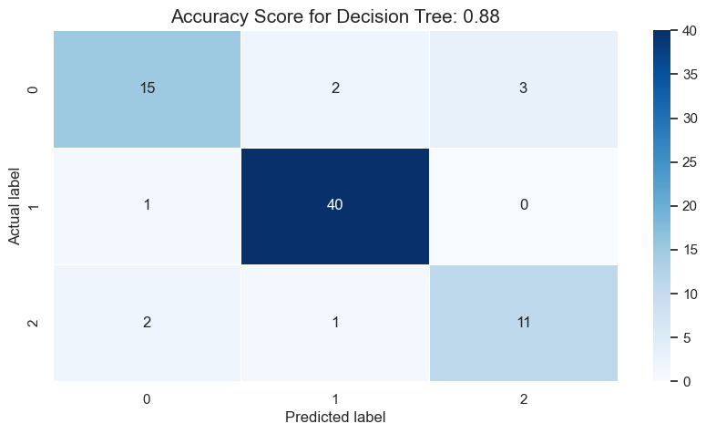
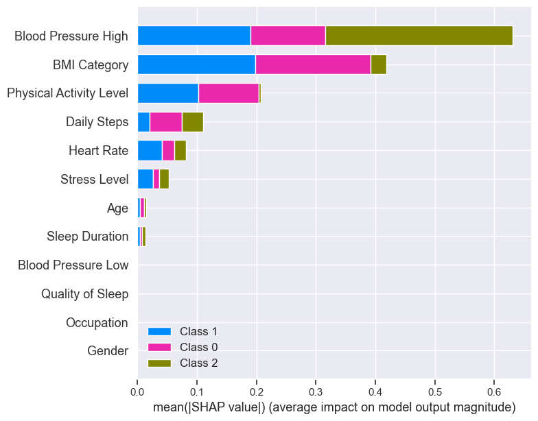
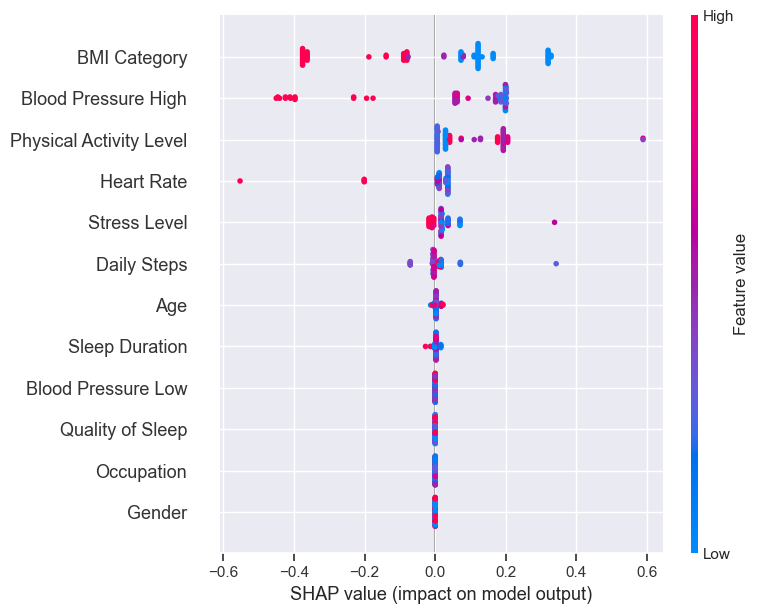
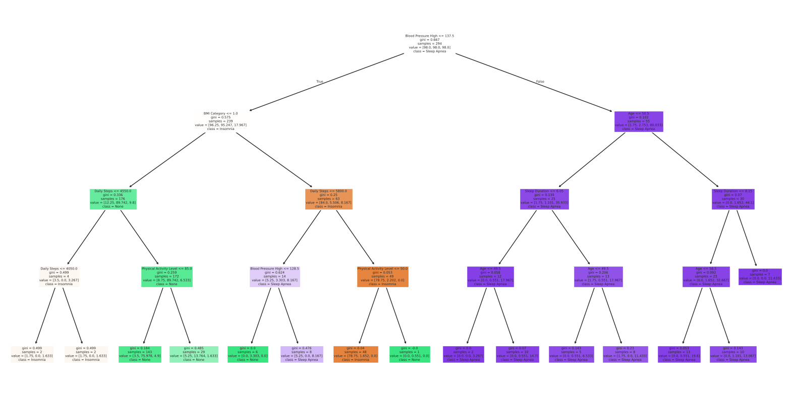

# Sleep Disorder Analysis and Prediction (Python, Machine Learning)

[](https://github.com/codeind/Sleep-Disorder-Analysis-ML/actions/workflows/ci.yml)

**Exploratory analysis of sleep, lifestyle and health data for 374 people, and a Decision Tree classifier that predicts insomnia or sleep apnea with 88% accuracy, explained with feature importance and SHAP, and checked for data leakage.**

🌐 **[Live dashboard](https://codeind.github.io/Sleep-Disorder-Analysis-ML/dashboard/)** · 📓 [Analysis notebook](notebooks/sleep_disorder_analysis.ipynb) · ✅ [Model validation](notebooks/model_validation.ipynb) · 🗄️ [SQL](sql/)

---

## Key results

| | |
|---|---|
| Data | 374 people, 12 attributes; 219 with no sleep disorder, 77 with insomnia, 78 with sleep apnea |
| Model | Decision Tree (max depth 4, tuned with `GridSearchCV`) |
| Accuracy | **88.0%** on the held-out test set (F1 0.88) |
| Leakage check | **89.3%** when identical profiles are kept out of training (`GroupKFold`), so the score holds |
| Hardest case | **63.6%** when each of the 132 unique profiles is counted once, against a 55.3% baseline |
| Top predictors | Systolic blood pressure (48% of importance) and BMI category (39%) |

[](https://codeind.github.io/Sleep-Disorder-Analysis-ML/dashboard/)

**What the data shows**
- **Weight is the strongest signal.** All 10 obese people and 87.2% of the 148 overweight people have a sleep disorder, against 7.4% of people with a normal BMI.
- **Disorders cluster by occupation.** 61 of 73 nurses have sleep apnea; 29 of 32 salespeople and 27 of 40 teachers have insomnia.
- **Sleep apnea is far more common among women** in this data: 36.2% of women against 5.8% of men.
- **Insomnia means shorter, worse sleep:** 6.59 hours and quality 6.53/10, against 7.36 hours and 7.63/10 for people without a disorder.
- **People with sleep apnea have the highest blood pressure** (average systolic 137.8 vs 124.0) and heart rate, and are older (49.7 vs 39.0 years).
- **More stress, less sleep:** average sleep falls from 8.23 hours at stress level 3 to 6.05 hours at level 8.

---

## Approach

```
Sleep_health_and_lifestyle_dataset.csv (374 rows)
   └─ Cleaning: drop Person ID, split blood pressure into systolic/diastolic, merge "Normal Weight" into "Normal"
   └─ EDA: counts and shares by gender, occupation and BMI; box, violin and pie charts; correlation heatmap
   └─ Model: label encoding → 80/20 split → heart-rate outliers removed from training (z-score > 3)
             → GridSearchCV over depth, split and leaf sizes → Decision Tree (balanced class weights)
   └─ Explain: feature importance, SHAP summary plots, confusion matrix
   └─ Validate: duplicate-profile check, GroupKFold, unique-profile cross-validation, baseline
```

### Exploratory analysis

| | |
|---|---|
| **Sleep disorder by gender, occupation and BMI**<br> | **Share of each disorder within each group**<br> |
| **Measures by sleep disorder**<br> | **Correlation heatmap**<br> |

More charts (distributions, violin plots, pie charts) are in [`images/original/`](images/original/).

### Model and explanation

| | |
|---|---|
| **Feature importance**<br> | **Confusion matrix (accuracy 0.88)**<br> |
| **SHAP summary, all classes**<br> | **SHAP values for the "None" class**<br> |



### Does the 88% hold up?

242 of the 374 rows are exact copies of another person's data, so there are only 132 distinct profiles, and 66 of the 75 test rows also appear in the training set. [`model_validation.ipynb`](notebooks/model_validation.ipynb) tests whether this inflates the score:

| Test | Accuracy |
|---|---|
| Original random 80/20 split | **88.0%** |
| `GroupKFold`: identical profiles never in both training and test | **89.3%** |
| 5-fold cross-validation on the 132 unique profiles | **63.6%** |
| Baseline: always predict the most common class (unique profiles) | 55.3% |

On profiles drawn the way the data is, the model stays at about 89%, so the result is not mainly caused by duplicates. Counting every distinct profile once is much harder, because the common, repeated profiles are also the easiest to classify.

### SQL

[`scripts/build.py`](scripts/build.py) loads the cleaned data into SQLite and runs the queries in [`sql/`](sql/); results are saved in [`sql/results/`](sql/results/).

| File | What it does |
|---|---|
| [`01_schema.sql`](sql/01_schema.sql) | Table with `CHECK` constraints on every range and category |
| [`02_data_quality.sql`](sql/02_data_quality.sql) | Row and unique-profile counts, duplicate and blood-pressure checks |
| [`03_disorder_overview.sql`](sql/03_disorder_overview.sql) | Share of each disorder and average sleep and health measures (window functions) |
| [`04_disorder_by_group.sql`](sql/04_disorder_by_group.sql) | Disorder rates by gender, BMI, occupation and age group |
| [`05_sleep_by_stress.sql`](sql/05_sleep_by_stress.sql) | Sleep duration, quality and disorder rate at each stress level |
| [`06_duplicate_profiles.sql`](sql/06_duplicate_profiles.sql) | The most repeated profiles |

The same script recalculates the model checks and the dashboard data, and a [GitHub Actions workflow](.github/workflows/ci.yml) runs it with tests on every push to confirm the 88% is still reproduced.

## How to run

```bash
pip install -r requirements.txt
python scripts/build.py                      # SQL results, model checks, dashboard data
pytest -q                                    # checks the results still match the notebook
jupyter notebook notebooks/                  # analysis and validation notebooks
```

The notebook [`sleep_disorder_analysis.ipynb`](notebooks/sleep_disorder_analysis.ipynb) is the original analysis made runnable on current library versions: the data is read with `keep_default_na=False` (newer pandas reads the label "None" as missing), `Series.append` is replaced with `pd.concat`, SHAP values are reshaped for newer SHAP versions, and the decision-tree plot uses the class names directly. It produces the same results as the original run, which is kept unchanged in [`docs/sleep_disorder_analysis_original_run.html`](docs/sleep_disorder_analysis_original_run.html).

## Data

[Sleep Health and Lifestyle Dataset](https://www.kaggle.com/datasets/uom190346a/sleep-health-and-lifestyle-dataset) (Kaggle). The data is **synthetic**: it was generated for illustration, so the patterns describe how the data was built, not medical cause and effect.

| Column | Description |
|---|---|
| Gender, Age, Occupation | Person details |
| Sleep Duration, Quality of Sleep | Hours per night; quality on a 1–10 scale |
| Physical Activity Level, Daily Steps | Minutes of activity per day; steps per day |
| Stress Level | 1–10 scale |
| BMI Category | Normal, Overweight or Obese ("Normal Weight" merged into "Normal") |
| Blood Pressure, Heart Rate | Systolic/diastolic; resting beats per minute |
| Sleep Disorder | None, Insomnia or Sleep Apnea (the prediction target) |

## Limitations

- The dataset is synthetic and small (374 rows, 132 distinct profiles), so the model shows the method rather than a clinically useful predictor.
- Label encoding gives occupations an arbitrary numeric order; one-hot encoding would be more appropriate for a linear model, although a decision tree is less sensitive to it.
- Some groups are tiny (10 obese people, 1 manager), so their percentages are unstable.

## Skills

Python (pandas, NumPy, Matplotlib, seaborn) · scikit-learn (Decision Tree, GridSearchCV, GroupKFold, metrics) · SHAP · exploratory data analysis · model validation and data leakage checks · SQL (SQLite) · GitHub Actions · data visualization (Chart.js)

## Repository structure

```
├── data/Sleep_health_and_lifestyle_dataset.csv
├── notebooks/
│   ├── sleep_disorder_analysis.ipynb     EDA, Decision Tree, SHAP (runnable)
│   └── model_validation.ipynb            duplicate rows and leakage checks
├── docs/sleep_disorder_analysis_original_run.html   original notebook run, unchanged
├── images/
│   ├── original/                         the 13 charts from the original run
│   └── decision_tree.png, web_dashboard.png
├── scripts/build.py                      SQL analysis, model checks, dashboard data
├── sql/                                  schema and analysis queries, results/ with outputs
├── reports/model_validation.json
├── tests/test_results.py
├── dashboard/                            interactive dashboard (GitHub Pages)
└── .github/workflows/ci.yml
```
